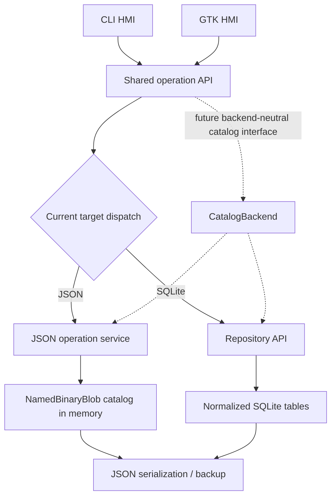
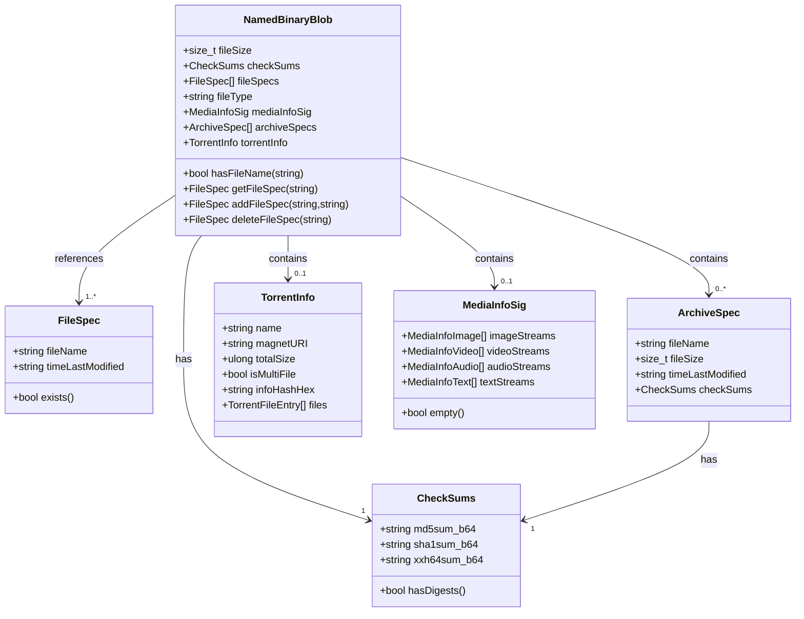
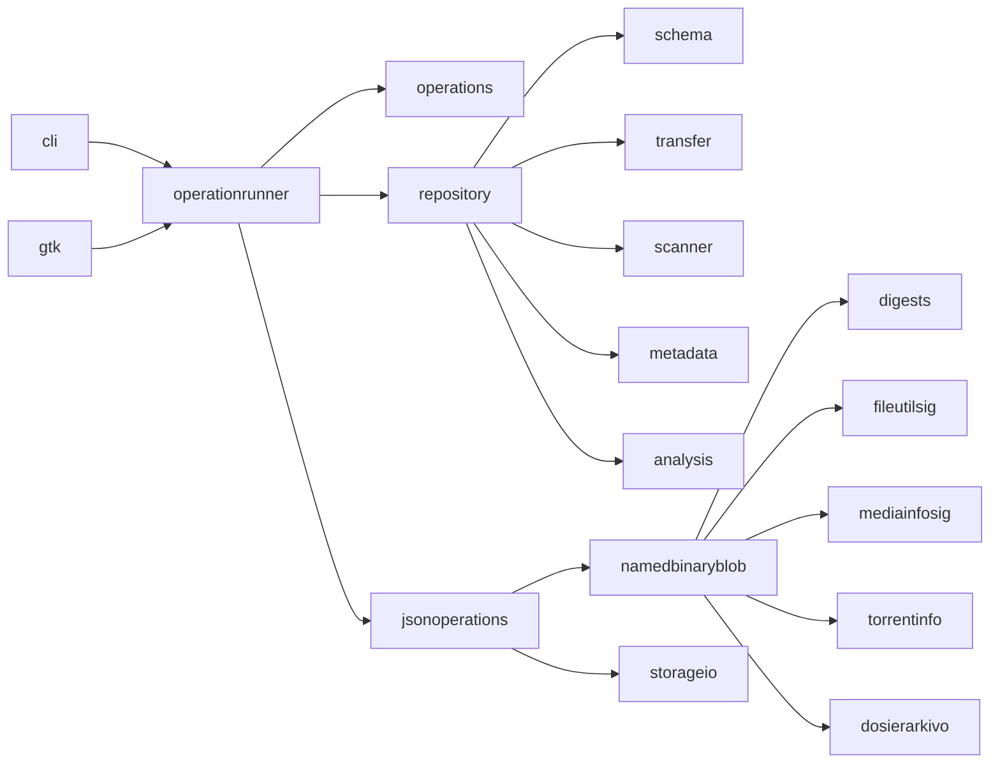

# Architecture and Data Model

This document describes the current `DosierSkanilo` architecture, the intended
storage-neutral catalog API, and the blob-centric data model. It distinguishes
implemented classes from the next API layer to design.

## 1. High-Level Workflow



## 1.1 Current API Boundary and Target

The domain vocabulary is content-centric: one `NamedBinaryBlob` describes one
binary payload; one or more `FileSpec` values identify filesystem paths that
refer to that payload. `CheckSums`, `MediaInfoSig`, `ArchiveSpec`, and
`TorrentInfo` are metadata attached to that payload.

The implemented storage APIs are not yet one polymorphic catalog interface:

- `Repository` in `repository/repository.d` is the concrete SQLite repository
  API. It owns lifecycle, relational queries, scan/metadata/analysis wrappers,
  and JSON transfer. `d2sqlite3` remains internal.
- JSON persistence is implemented by the wrapper serializer in
  `model/namedbinaryblob.d` and JSON services in `service/`. The new
  `runOperation()` dispatcher selects the JSON or repository executor from an
  explicit `OperationTarget`; it is an operation facade, not yet a general
  `CatalogBackend` read/query interface.
- The GUI's `DirectorySource` currently adapts JSON projections and public
  `Repository` DTO/query methods. This abstraction is GUI-owned rather than a
  backend public base class.

The desired public frontend boundary is a storage-neutral `CatalogBackend`
contract with JSON and SQL implementations behind a factory. Its read/query
surface should cover the same logical directory/file sequence, stable identity,
filter/sort state, details, and cursors for both stores. Long-running operations
should use that same backend selection rather than branching in each HMI. The
contract and migration steps are tracked in `SQLITE-IMPLEMENTATION-PLAN.md` under
WP-13; the interface should be added only after the value types and semantics
below are frozen.

### Product responsibilities

- **Catalog/domain layer:** index filesystem references, identify content by
  complete digests, attach metadata, find duplicates, and return filtered logical
  subsets without depending on either HMI.
- **Storage layer:** keep JSON compatibility and SQLite repository state behind
  adapters. SQLite is the current scale-oriented working store; JSON is a
  supported standalone catalog and interchange format.
- **CLI HMI:** expose useful scriptable commands, stable plain/JSON output, and
  clear stdout/stderr/exit behavior. It must not contain an independent scan or
  analysis algorithm.
- **GTK HMI:** browse the same logical catalog, visualize and preview files,
  navigate virtual archive members, and invoke the same operations. It must not
  query SQLite or mutate serialized records directly.

### Implemented class responsibilities

| Type | Current responsibility | Boundary/limitation |
| --- | --- | --- |
| `NamedBinaryBlob` | JSON-compatible record for a payload, checksum/metadata, and one or more `FileSpec`s | Mixes payload and filesystem references; keep as the v3 serializer model, not the future backend interface |
| `FileSpec` | One physical filesystem path and its observed timestamp | Has no source-kind or archive-entry locator today |
| `ArchiveSpec` | Basic archive member path, size, timestamp, optional checksums | Nested metadata only; it is not a queryable/deduplicated content blob |
| `TorrentInfo` / `TorrentFileEntry` | Torrent-level facts and torrent member paths | Torrent members are also nested metadata, not ordinary catalog references |
| `Repository` | Concrete SQLite lifecycle, query, transfer, and synchronous convenience API | SQLite-backed concrete class; no common JSON/SQLite catalog superclass yet |
| `RepositoryDirectory` / `RepositoryFile` / page DTOs | Typed bounded SQLite read results | Stable cursor IDs are repository identities; GUI JSON projections are separately built |
| `OperationTarget` / operation requests | Explicit storage mode and scan/metadata/analyze options | `runOperation()` currently dispatches to storage-specific services |
| GUI `DirectorySource` | JSON/SQLite tree-query adapter used by GTK | Currently defined in the GUI repository, not the backend public catalog API |

### Desired content/reference model

The target model separates content identity from where content is addressable:

```text
Catalog -> ContentBlob (size, digest set, extracted metadata)
        -> ContentReference (filesystem source or archive-entry source)
```

Several references can point to one content blob. A filesystem reference carries
the physical path and observed timestamp. An archive reference carries a
container reference plus a structured entry locator; it must not be represented
by concatenating an archive filename and an inner path into an ordinary
filesystem string. The displayed virtual path is a presentation of that locator,
not its identity. Nested archives can extend the locator with a parent-entry
chain.

The archive locator design must define how duplicate names inside one archive
are distinguished (for example, a stable entry ID/ordinal in addition to the
normalized path). It must also define what archive operations cache: the
container content identity, entry-list fingerprint, extractor/version state,
and per-entry content identity. Size, timestamp, or archive CRC may help decide
whether to recheck an entry, but are not a substitute for the catalog's strong
content digest when merging arbitrary payloads.

`dosierarkivo.FileArchive` is the format adapter: today it lists names and
extracts one entry to a destination directory. It does not define catalog
identity, persistence, or virtual path semantics. The future API should add a
bounded entry descriptor and per-entry/stream extraction contract before
`ArchiveSpec` is replaced. That permits listing without unpacking the entire
archive, hashing entries in bounded batches, previewing a selected entry on
demand, and rescanning only entries invalidated by a changed container or
extractor version.

## Layer Order for API Refinement

The intended dependency order is:

1. **Domain values:** content identity, checksums, metadata state, physical and
   virtual references, and stable IDs independent of JSON, SQLite, or GTK.
2. **Storage adapters:** `JsonCatalogBackend` and `SqlCatalogBackend` implement
   the same transaction, import/export, cursor, and query contracts. SQLite is
   the only implemented SQL engine; an interface does not imply another SQL
   engine is already supported.
3. **Catalog API:** a factory opens a backend from an explicit target and
   returns source-neutral query projections and operation services.
4. **Operation API:** scan, metadata, analysis, archive indexing, progress,
   cancellation, pause/resume, and committed-change results operate on the
   catalog contract, not storage-specific types.
5. **HMI adapters:** CLI formatting/options and GTK dialogs/views map to those
   public values; neither frontend owns persistence or duplicate/archive logic.

WP-13 in the implementation plan is the bottom-up migration sequence. The
current `Repository` and JSON APIs remain supported while the interface is
introduced, then become compatibility facades over the adapters.

## 2. Core Domain Model (UML)



## 3. Job Execution Model

`runScannerJobs()` in `source/dosierskanilo/service/scanning.d` supports:

- Single-thread mode
- Multi-thread mode via `std.parallelism.TaskPool`

Each blob can queue independent jobs:

- `updateDigests`
- `updateFileType`
- `updateMediaInfo`
- `updateArchives`
- `updateTorrentInfo`

The legacy JSON `runScannerJobs()` function retains its CLI-oriented options
shape. Current CLI and GTK operations use `runOperation()`, which executes
controlled SQLite scan/metadata/analysis and explicit JSON scan/analyze requests.
Synchronous `Repository.scan()`, `updateMetadata()`, and `analyze()` are
convenience wrappers over the controlled services.

WP-09.1 and WP-09.1b define frontend-neutral request, progress, cancellation,
and cooperative pause/resume contracts. Controlled SQLite/JSON executors,
cross-process target leases, and initial CLI/GTK adapters are implemented. A
paused operation holds no active SQLite transaction or statement; it retains
the per-target write lease until it resumes or is cancelled. Remaining parity and
process-level lifecycle coverage is tracked in the backend plan.

Scheduling policy details:

- Most jobs are queued only when target metadata is missing.
- Media rescan semantics are consistent across execution modes:
  - `--media-info --rescan-media-info` forces refresh in single-thread and
    multi-thread mode

## 4. Duplicate Detection Strategy

Duplicates are identified by complete checksums grouped by payload size and SHA1.
The legacy JSON helper and the controlled JSON executor share the same merge
helpers; the SQLite adapter performs the equivalent work relationally.

1. Filter to blobs with complete digests.
2. Group by `fileSize`.
3. Within each size group, group by SHA1.
4. Merge equal blobs (`mergeDataClassObjects`) by combining file specs.
5. Remove only records invalidated by a successful merge. Remove missing source
   references only when the request explicitly enables `dropMissing`.

This keeps the model content-oriented while preserving all known file names.

## 5. Serialization and Migration

The current interchange format is JSON using `NamedBinaryBlobWrapper`. The
version-3 wrapper contains:

- `dataVersion`
- `dataArray`
- optional `mediaInfoVersion`
- optional `fileUtilityVersion`

The complete field inventory, legacy formats and output compatibility rules
are documented in [JSON-FORMAT.md](JSON-FORMAT.md).

On load, legacy fields are migrated in `fixupDataClassArrayIn()`. On save,
outbound compatibility cleanup happens in `fixupDataClassArrayOut()`. The
single-path output form (`fileName` and `timeLastModified`) and the multi-path
form (`fileSpecs`) both represent the same internal `FileSpec[]` relationship.

Relevant code:

- `deserializeDataClassJsonString`
- `deserializeDataClassJsonFile`
- `serializeDataClassWrapperFile`

The normalized SQLite repository is described in
[DATABASE.md](DATABASE.md). JSON remains the import/export boundary rather than
the query store for large repositories.

### Shared Read API Target

JSON and SQLite should become implementations behind one read-only
`CatalogBackend` API. The common API returns directory/file projection DTOs and
accepts the same filter and sort state. It may expose an internal cursor with
`nextCursor` and `hasMore`, but consumers see one logical result sequence rather
than storage-specific pages. Stable IDs support `next` and `previous` navigation
within the active filtered/sorted sequence. This contract is a target, not a
claim that the public API is already polymorphic.

JSON may keep its complete index in memory. SQLite should use bounded keyset or
cursor queries so large repositories do not materialize their complete catalog.

The implementation sequence is tracked in
[SQLITE-IMPLEMENTATION-PLAN.md](SQLITE-IMPLEMENTATION-PLAN.md).

## 6. Archive Handling

`source/dosierarkivo/archive.d` provides:

- Factory `fileArchive()` to pick implementation by extension
- Backends: `zip`, `tar`, `rar`, `7z`
- `getEntries()` and `extractEntry()` interface

`updateArchives()` currently lists an archive, extracts entries one at a time to
a temporary directory when deep scanning is enabled, calculates checksums, and
stores basic metadata in `ArchiveSpec[]` attached to the containing
`NamedBinaryBlob`. `ArchiveSpec` is not a first-class `NamedBinaryBlob`: archive
entries cannot yet participate in the normal blob deduplication, path query, or
metadata operation APIs. The scanner does not persist an archive fingerprint or
per-entry stable identity beyond the container blob and entry path.

The desired content model treats an archive as a container whose entries are
virtual content references. Each entry should resolve to a content blob and use
a structured locator containing its parent/container identity and archive path;
an ambiguous synthetic filesystem path is not the identity. Indexing should
support bounded listing and per-entry/on-demand extraction, reuse unchanged
entry metadata, and refresh only when the container content changes. The
concrete locator, duplicate-entry policy, nested-archive behavior, and streaming
extraction contract are staged under WP-13 before schema/API changes.

## 7. Torrent Handling

`source/dosierskanilo/metadata/torrentinfo.d` includes:

- Internal bencode parser
- SHA1 info-hash computation over bencoded `info` dictionary
- Magnet URI creation
- Single-file and multi-file torrent support

Output is stored in `TorrentInfo` per blob.

## 8. Module Dependencies



The future `CatalogBackend` interface belongs between `operationrunner` and the
storage-specific `repository` / JSON implementations. It should not expose
SQLite types or JSON serializer types.

## 9. Practical Implications

- The scanner can represent renamed or duplicated files cleanly via `fileSpecs`.
- Metadata extraction is modular and can be expanded with additional tools.
- Archive and torrent support allows deeper content intelligence than plain file
  tree scans.
- JSON persistence plus fixups protects compatibility across schema evolution.
- SQLite is the normalized current-state store for repository-scale scans and
  GUI queries; direct JSON is an explicit standalone mode and interchange path.
